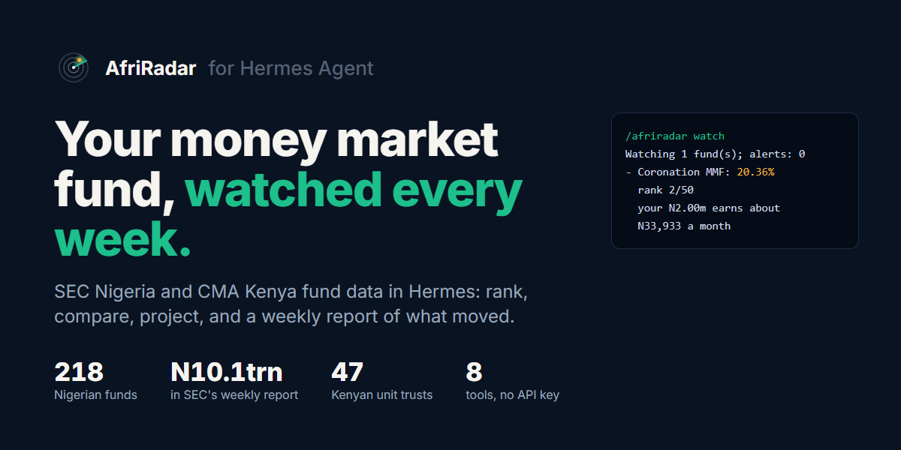
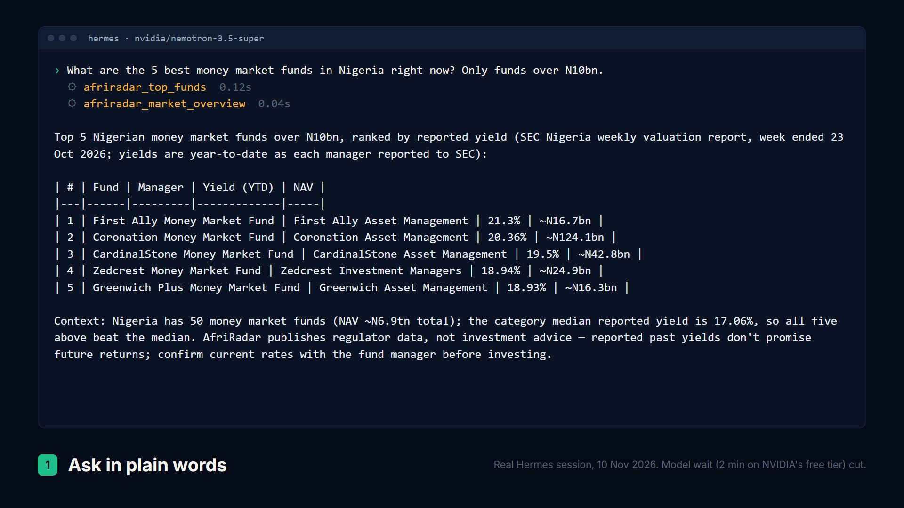
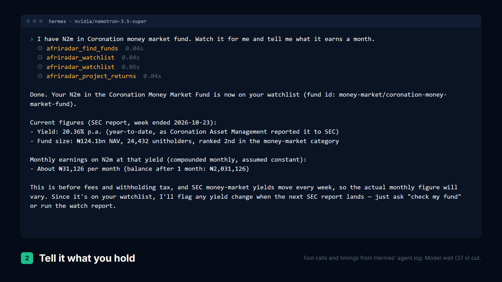
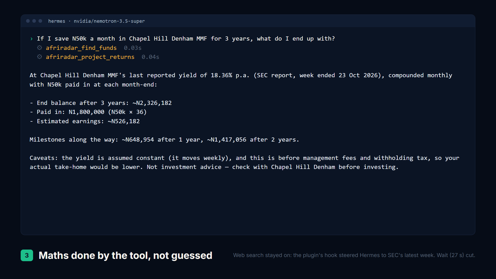
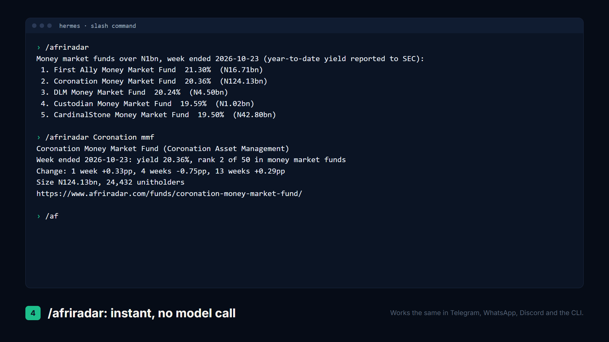

# AfriRadar for Hermes



Ask Hermes about Nigerian mutual funds and Kenyan unit trusts, and let it watch the funds you hold.

Nigeria's 218 collective investment schemes hold N10.1 trillion across 1.65 million unitholder
accounts. The only official record of how those funds perform is a weekly Excel file on SEC
Nigeria's website. This plugin gives Hermes that record, every week since January 2025, through
[AfriRadar](https://www.afriradar.com), which republishes SEC Nigeria's weekly valuation report and
CMA Kenya's quarterly unit trust bulletin as clean CSV.

Nigeria is the first case. The same pattern works for any regulator that publishes its figures as
a spreadsheet: clean the file once, and an agent can rank, project and watch it for its user.

A real session (Hermes on NVIDIA's free Nemotron model, 10 Nov 2026; tool calls from Hermes'
own log):

```
› I have N2m in Coronation money market fund. Watch it for me and tell me what it earns a month.
  ⚙ afriradar_find_funds 0.04s · afriradar_watchlist 0.04s · afriradar_watchlist 0.06s · afriradar_project_returns 0.04s

Done. Your N2m in the Coronation Money Market Fund is now on your watchlist.
Current figures (SEC report, week ended 2026-10-23):
- Yield: 20.36% p.a. ... ranked 2nd in the money-market category
Monthly earnings on N2m at that yield (compounded monthly, assumed constant):
- About ₦31,126 per month
```

And what `/blueprint afriradar:weekly-fund-watch` sends, fired through Hermes' cron with the
watchlist last seen at SEC's 16 October report:

```
Alert: Stanbic IBTC Money Market Fund rose 77 bps (to 17.14%), past the 50 bps alert threshold;
rank moved up from 34 to 25 of 50.

• Coronation Money Market Fund: 20.36%, +33 bps, rank 2 of 50 (was 4). On N2,000,000 that is N407,200 per year.
• Stanbic IBTC Money Market Fund: 17.14%, +77 bps (alert), rank 25 of 50 (was 34). On N750,000 that is N128,550 per year.

Data from SEC Nigeria via AfriRadar, not investment advice.
```

No API key, no account, no payment. Data is read from public files and cached on your machine.

| | |
|---|---|
|  |  |
|  |  |

## What it adds

**Eight tools** (toolset `afriradar`)

| Tool | What it answers |
|---|---|
| `afriradar_market_overview` | How big is the market, what is each category paying (Nigeria or Kenya) |
| `afriradar_find_funds` | Find funds by name or manager ("Stanbic", "ARM eurobond", "chapel hill mmf") |
| `afriradar_top_funds` | Rank a category by yield, size or unitholders, with a minimum fund size |
| `afriradar_fund_detail` | One fund: yield, rank, category median, 1/4/13 week change, weekly history, SEC source file |
| `afriradar_compare_funds` | 2 to 6 funds side by side, with 13-week low, high and average yield |
| `afriradar_project_returns` | "What will N500k plus N50k a month be in 2 years?" done as arithmetic, not by the model |
| `afriradar_watchlist` | Add, update, remove and list the funds you hold, with the amount |
| `afriradar_watch_report` | What changed since the last report: yield moves in basis points, alerts past your threshold, rank changes, your income at the new yield, higher-yielding peers when a yield drops |

**`/afriradar` slash command.** Instant answers with no model call, in the CLI and in every
messaging channel: `/afriradar` (top money market funds over N1bn), `/afriradar top dollar`,
`/afriradar <fund>`, `/afriradar watch`, `/afriradar market`, `/afriradar kenya`.

**Two Automation Blueprints.** `/blueprint afriradar:weekly-fund-watch` runs the watch report
every week and sends you the changes on Telegram, WhatsApp or wherever you talk to Hermes.
`/blueprint afriradar:money-market-digest` sends the week's top money market funds above a size
you pick.

**A bundled skill**, `afriradar:african-fund-research`, with the rules for honest answers: say
which week, say what a yield is, compare like with like, never do the maths in your head, no advice.

**A routing hook** (`pre_llm_call`). When a message is about Nigerian or Kenyan funds, it adds two
sentences to that turn pointing the model at the AfriRadar tools. Without it, a model that also
has web search tends to search, land on an older week on some aggregator, and do the compounding
in its head; with it, the same question gets SEC's latest week and the tool's arithmetic. Other
turns are untouched, and the `routing` setting turns it off.

## Install

```bash
hermes plugins install Risingtell/hermes-afriradar
hermes plugins enable afriradar
```

Then start Hermes and try:

- "What are the best money market funds over N10bn right now?"
- "Compare Stanbic, ARM and Coronation money market funds"
- "I put N1.5m in Cowry Eurobond fund. Watch it."
- "If I save N50k a month in Chapel Hill Denham MMF for 3 years, what do I end up with?"
- "How big are Kenya's unit trusts?"
- `/blueprint afriradar:weekly-fund-watch`

## Settings

In `config.yaml` under `plugins.entries.afriradar.settings`, or in the Desktop app under
Settings, Plugins, AfriRadar:

| Key | Default | Meaning |
|---|---|---|
| `data_url` | `https://www.afriradar.com/data/` | Where the CSV files are read from |
| `cache_hours` | `6` | How long a downloaded report is reused before asking for a newer one |
| `alert_bps` | `50` | A watched fund's yield move at least this big is flagged (50 = 0.50 points) |
| `routing` | `true` | Add the two-sentence routing note to turns about Nigerian or Kenyan funds |

## How it works

- **Data.** SEC Nigeria publishes one Excel report a week covering every collective investment
  scheme (218 funds in 9 categories in the week ended 23 October 2026). AfriRadar parses it,
  checks every section adds up to SEC's grand total, and publishes CSV files with the SEC source
  link on every row. CMA Kenya's quarterly bulletin gives assets for 47 unit trust schemes.
- **Downloads.** Standard library only. The nine category files download in parallel (about a
  second cold, instant warm), are kept in `<hermes home>/plugin-data/afriradar/cache`, and are
  revalidated with ETags after `cache_hours`, so an unchanged report costs a few hundred bytes.
  With no connection the saved copy is used and every answer says so. An HTML page served in
  place of a CSV (a captive Wi-Fi portal) never replaces good data.
- **Freshness.** AfriRadar checks SEC's page every day and publishes a new week the day SEC posts
  it. SEC does not post every Friday: in November 2026 its newest report was still the week ended
  23 October. Every answer names the week, so a gap is visible rather than hidden.
- **Yields.** The year-to-date column each manager reports to SEC, exactly as AfriRadar shows it.
  A zero means "not reported". A figure SEC printed that cannot be real is not shown.
- **Projections.** For money market funds the reported yield is an annual rate, so it is used as
  is. For every other category SEC's figure is the return since 1 January, so projections and
  holding values use the fund's own unit price instead, annualised over at least six months of
  weekly reports; with less history the tool says so and asks for a rate.
- **Fund names.** People say "Chapel Hill MMF" or "coronaton money market". Matching weighs the
  distinctive words (the manager's brand) above words half the funds share, so "Cowry money
  market" offers Cowry's four funds, not fifty money market funds.
- **Watchlist.** Stored in the plugin's profile-scoped state. Each report records a snapshot, so
  the next report shows only what is new; `mark_seen: false` peeks without moving it.

## Disclosure

- **Network:** HTTPS GET requests to `www.afriradar.com/data/*.csv` only (or your `data_url`).
- **Files written:** cached CSVs under `<hermes home>/plugin-data/afriradar/cache/`; the
  watchlist (fund ids, optional amounts and notes) in the plugin's Hermes state. Nothing leaves
  your machine.
- **Hook:** one `pre_llm_call` hook. It reads only the current user message and, when that message
  is about Nigerian or Kenyan funds, appends a fixed two-sentence note to the turn. No network
  call, no storage. Off with `routing: false`.
- No shell commands, no background processes, no credentials, no telemetry.

## Not investment advice

AfriRadar publishes regulator data. Yields are what each fund manager reported to SEC, and a past
yield does not promise a future one. The plugin and its skill tell Hermes to present figures, not
recommendations. Check with the fund manager before you invest.

## Development

```bash
cd tests
uvx --with pyyaml pytest
hermes plugins validate .. --install-deps
```

Tests run against real SEC data saved in `tests/fixtures` (week ended 23 October 2026).

Published by Rising Technology and Digital Trend, Kano, Nigeria. MIT licence.
